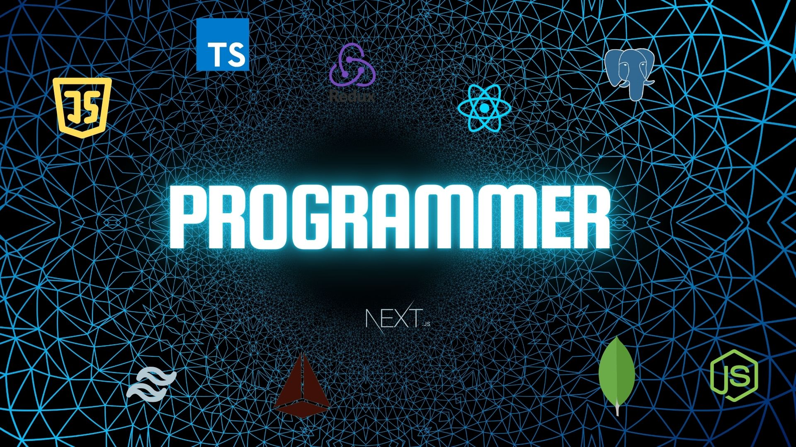

<h1 align="center">👋 Hi, I'm Mahabub Alam</h1>

<h3 align="center">Full Stack Web Developer</h3>

  React | Node.js | MongoDB | Next.js

  Continuous Learning | Practice | Code Review | Project Building

  

---

  

---

## 🧰 Languages and Tools

  
   
  

## 📊 GitHub Stats

  

 

  

 

  

  

---

## 🚀 About Me

I'm a **Full Stack Web Developer** passionate about building **scalable, high-performance web applications** using modern JavaScript technologies.

- 💻 Frontend: **React, Next.js, Tailwind CSS**
- 🧠 Backend: **Node.js, Express, MongoDB, Prisma, PostgreSQL**
- 🧩 Strong focus on **clean architecture, performance & UX**
- 🌍 Currently working in **Dammam, Saudi Arabia**
- 🔎 Actively seeking **remote Full Stack / Frontend roles**

---

## 📦 Featured Projects

<table align="center">
  <thead>
    <tr>
      <th>#</th>
      <th>Project Name</th>
      <th>Type</th>
      <th>Tech Stack</th>
      <th>GitHub</th>
      <th>Live</th>
      <th>Status</th>
    </tr>
  </thead>
  <tbody>
    <tr>
      <td>1</td>
      <td>Employee Management System</td>
      <td>Full Stack Web App</td>
      <td>React, Node.js, MongoDB, Tailwind</td>
      <td><a href="https://github.com/Mahabub2030/Employee-Management-Frontend">GitHub</a></td>
      <td><a href="https://employee-management-system-chi-bay.vercel.app/">Live</a></td>
      <td>Ongoing</td>
    </tr>
    <tr>
      <td>2</td>
      <td>Digital Wallet System</td>
      <td>Full Stack Web App</td>
      <td>React, Redux Toolkit, Express, MongoDB</td>
      <td><a href="https://github.com/Mahabub2030/-Wallet-Client">GitHub</a></td>
      <td><a href="https://wallet-client-one.vercel.app/">Live</a></td>
      <td>Active</td>
    </tr>
    <tr>
      <td>3</td>
      <td>Travel Buddy & Meetup</td>
      <td>Full Stack Web App</td>
      <td>Next.js, Tailwind, ShadcnUI, Prisma, PostgreSQL</td>
      <td><a href="https://github.com/Mahabub2030/Travel-Client">GitHub</a></td>
      <td><a href="https://travel-buddy-and-meetup-client.vercel.app/">Live</a></td>
      <td>Active</td>
    </tr>
    <tr>
      <td>4</td>
      <td>Attendance Sheet</td>
      <td>Utility App</td>
      <td>HTML, JavaScript, Tailwind, html2pdf</td>
      <td><a href="https://github.com/Mahabub2030/Attendance-sheet-For-Daco">GitHub</a></td>
      <td><a href="https://mahabub2030.github.io/DACO/">Live</a></td>
      <td>Completed</td>
    </tr>
    <tr>
      <td>5</td>
      <td>Foods</td>
      <td>Front End</td>
      <td>HTML, CSS, JavaScript</td>
      <td><a href="https://github.com/Mahabub2030/Food-">GitHub</a></td>
      <td><a href="https://mahabub2030.github.io/Food-/">Live</a></td>
      <td>Completed</td>
    </tr>
  </tbody>
</table>

---

## 👀 Current Overview

- 🔭 Working at **Safari Group Limited** in an **Administrative Role**, Dammam, Saudi Arabia
- 🌱 Learning **Next.js, TypeScript, and Backend Optimization**
- 👯 Looking for **Remote Web Developer roles**
- ⚡ Fun fact: I enjoy turning complex logic into clean UI

## 🤝 Connect With Me

  
  
  
  

---

  Thanks for visiting my profile! 🚀
   
  Let's build something impactful together.

